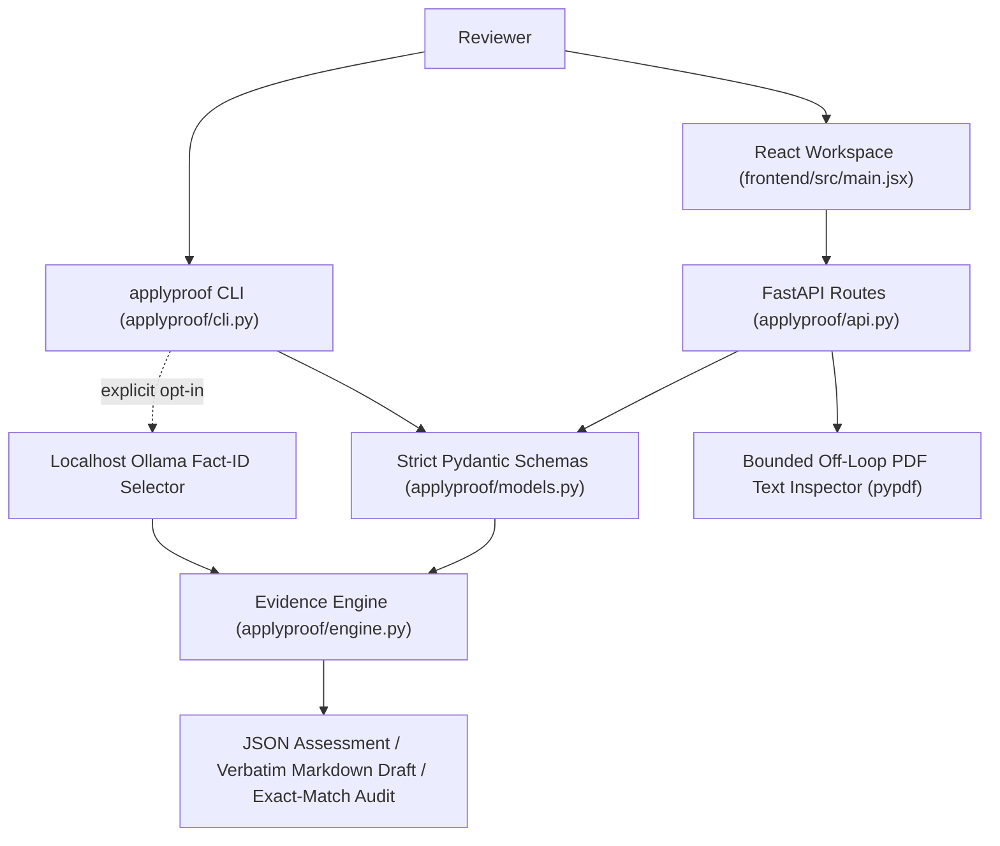
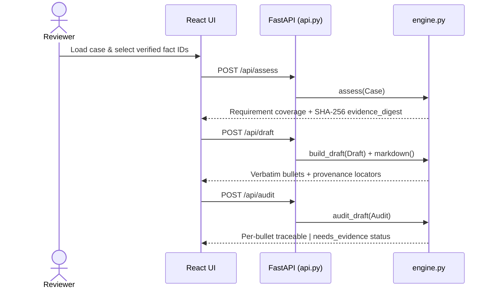

# Architecture: applyproof

Crosscheck: 2026-11-08 WIB. The repository-local offline checks completed with exit code 0 in an interpreter/environment containing the declared dependencies. Hardware, live providers, deployment and unexecuted CI platforms are separate evidence boundaries.

Reviewed on 2026-11-07 against the local working tree (`.`). `graphify-out/graph.json` provides the local AST symbol graph.

## 1. System Context & Data Flow

Traceable job-application evidence workbench (FastAPI + React + CLI) that validates structured candidate facts via strict Pydantic models, evaluates requirement & location coverage, generates verbatim evidence drafts, audits edited bullets by normalized exact match, and inspects PDF text layers in memory.



## 2. Execution & Pipeline Sequence



## 3. Module Breakdown

| Path | Responsibility |
| :--- | :--- |
| `applyproof/models.py` | Strict `extra='forbid'` Pydantic models (`Case`, `Profile`, `Fact`, `Source`, `Job`, `Draft`, `Audit`) with unique-ID invariants and size caps. |
| `applyproof/engine.py` | NFKC/whitespace normalization, SHA-256 `evidence_digest`, pre-indexed requirement matching, verbatim `build_draft`, exact-match `audit_draft`, Markdown renderer, and localhost Ollama ID selector. |
| `applyproof/api.py` | Request-size guard middleware, `/api/health`, `/api/demo`, `/api/assess`, `/api/draft`, `/api/audit`, async `asyncio.to_thread` `/api/pdf-check`, and optional static UI mount. |
| `applyproof/cli.py` | CLI workflow supporting manual or localhost Ollama fact-ID selection and JSON export. |
| `frontend/src/main.jsx` | Session-scoped React workspace managing case state, fact selection, draft preview, bullet auditing, and PDF inspection. |
| `tests/` | 6 pytest modules (`test_models_and_engine.py`, `test_evidence.py`, `test_api_and_pdf.py`, `test_cli.py`, `test_provider.py`, `test_review_pipeline.py`). |

## 4. State Management & Failure Handling

Backend routes are completely stateless with no database or disk upload retention (`UploadFile` is bounded to 5 MB + 1 byte, closed in `finally`, and parsed in memory via `asyncio.to_thread`). React holds session state in memory and invalidates downstream draft/audit results whenever inputs change.

## 5. Verification Commands

```powershell
Set-Location 'python' -m pytest -q
```

## 6. Integration Boundaries

Never fabricates resume prose or submits external applications; optional Ollama integration selects existing verified fact IDs only and is mocked in automated tests.
