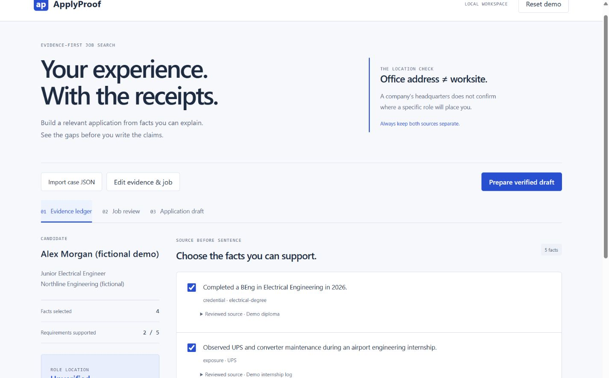

# ApplyProof

Prepare job applications from an evidence ledger. Separate office addresses from actual worksite locations, distinguish exposure from hands-on skill, and draft only claims that map to reviewed facts.



## Why this exists

A job-search assistant can produce a polished CV while inventing experience or assuming a headquarters address is the role's location. ApplyProof makes those uncertainties visible **before** drafting. Its optional AI chooses evidence IDs rather than writing achievements.

This is an original implementation inspired by evidence-grounding practices in [MadsLorentzen/ai-job-search](https://github.com/MadsLorentzen/ai-job-search). It does not copy that repository's candidate profile, application documents or orchestration implementation.

## Start locally

Windows: double-click **Run Applyproof.cmd**, or run `powershell -ExecutionPolicy Bypass -File run.ps1`. Requires Python 3.11+ and Node.js 22.12+ or 24+. Open http://127.0.0.1:8765.

Other platforms:

```sh
python -m venv .venv
source .venv/bin/activate
pip install -e '.[dev]'
cd frontend
npm ci
npm run build
cd ..
python -m uvicorn applyproof.api:app --host 127.0.0.1 --port 8765
```

## Workflow

1. Start with the fictional demo, import a case JSON, or edit its facts and job requirements.
2. Add exact source excerpts and mark a source reviewed only after checking it yourself. The program does not authenticate certificates or scrape employer sites.
3. Review explicit skill-tag coverage. Exposure can support an exposure requirement, but cannot prove hands-on proficiency. A credential does not automatically prove workplace fluency.
4. Check role location separately. A reviewed office address alone leaves the worksite unverified. Conflicting reviewed role cities require clarification.
5. Select reviewed facts and prepare a verbatim, traceable draft. Export Markdown and JSON with fact IDs, source excerpts, unresolved requirements and an evidence SHA256 digest.
6. Paste edited bullets into the traceability check. Exact normalized matches remain traceable; every rewrite requires fresh evidence review. This is a narrow check, not semantic lie detection.

The PDF checker counts extracted characters per page to identify CVs that may lack a text layer. It does not measure an ATS score, predict recruitment results, perform OCR or verify visual layout.

## Optional AI, constrained by facts

With local Ollama already running:

```sh
applyproof examples/demo.json --ollama qwen2.5:7b --output application-review.json
```

AI receives reviewed fact text, skill tags and job requirements. It returns IDs only. Missing, duplicated or unreviewed IDs are rejected. Final bullets always copy the stored fact text. For manual drafting:

```sh
applyproof examples/demo.json --select degree ups python --output application-review.json
```

Without `--select` or `--ollama`, the CLI exports only the evidence assessment. Ollama adapter tests use controlled responses; no live-model quality claim is made.

## Privacy and limitations

- The local web session uses memory only. Nothing automatically persists in browser storage, analytics or a database. Export JSON to retain your work.
- PDF uploads are inspected by the local server in memory and are not saved. Keep the server bound to localhost; it is not a multi-user hosted service.
- No application submission, inbox access or social-account automation exists.
- User-entered source excerpts, review flags and skill tags can be wrong. Human source review remains necessary. No unsupported confidence percentage or hiring recommendation is produced.
- A SHA256 digest tracks the exact case used. It does not prove the truth of its contents.
- Only fictional applicant data belongs in this repository. Keep private CVs, certificates and photographs outside it.

## Development

```sh
pip install -e '.[dev]'
python -m pytest
cd frontend && npm ci && npm run build
```

React/Vite frontend, FastAPI API, Pydantic schemas, pypdf text inspection and an independently usable CLI. See [examples/demo.json](examples/demo.json) and [CONTRIBUTING.md](CONTRIBUTING.md). MIT licensed.
